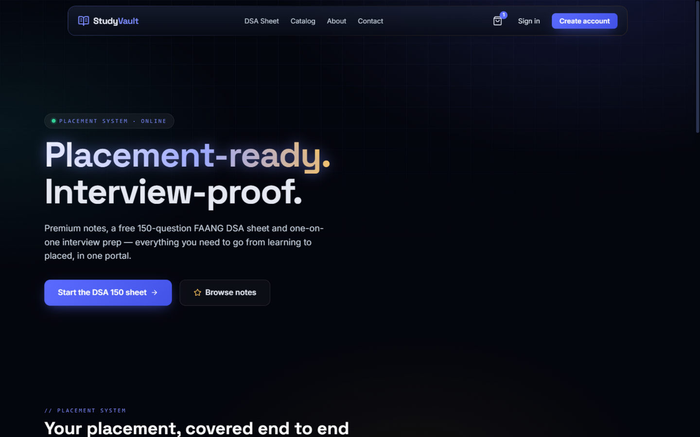
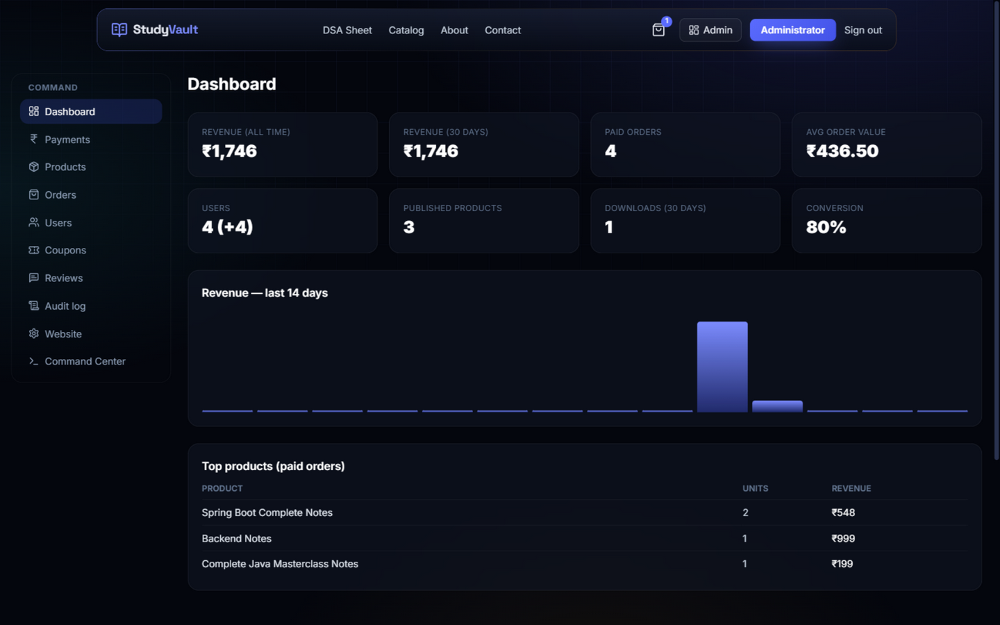
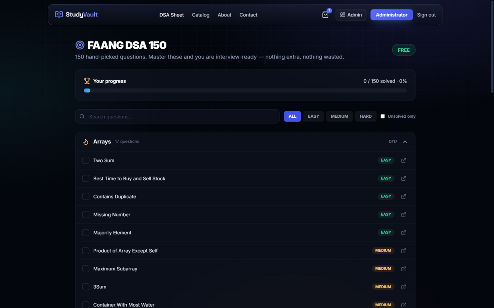
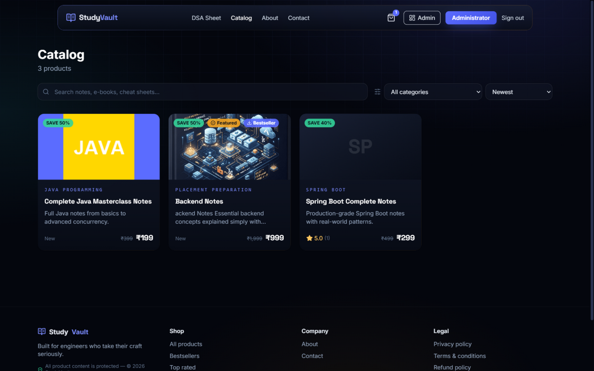
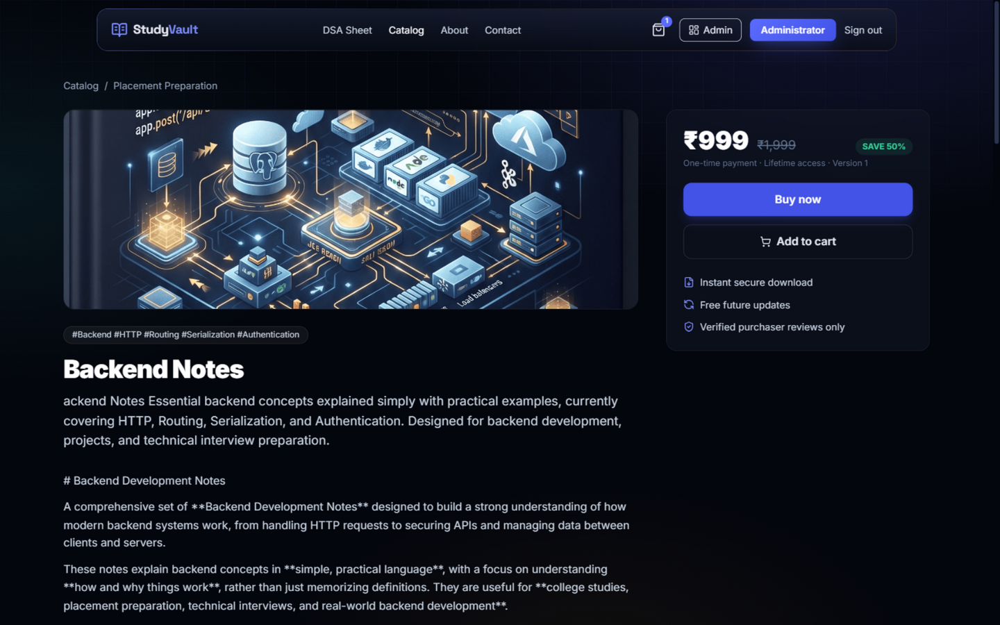

# StudyVault


A production-grade **digital study-material marketplace** for selling programming and
educational resources (notes, e-books, cheat sheets, interview prep packs) with real
payments, secure file delivery, an admin command center, and full operational tooling.

> **Status:** actively built phase-by-phase (see [Phase status](#phase-status)).
> Security, payment integrity, and authorization are prioritized above visual effects.

---

## Screenshots

| Marketplace home | Admin command center |
| :---: | :---: |
|  |  |

| FAANG DSA 150 sheet | Product catalog |
| :---: | :---: |
|  |  |

| Product detail — secure delivery |
| :---: |
|  |

## Stack

| Layer     | Technology |
|-----------|------------|
| Frontend  | Next.js (App Router) · TypeScript · Tailwind CSS · Framer Motion · React Three Fiber (3D hero) · Zod · React Hook Form |
| Backend   | Java 21 · Spring Boot 3.5 · Spring Security · Spring Data JPA (Hibernate) · REST API |
| Database  | PostgreSQL 17 + Flyway migrations |
| Storage   | Private AWS S3 (MinIO locally) — paid files are **never** publicly reachable |
| Payments  | Razorpay (signature + webhook verification, idempotent) — provider-abstracted |
| Email     | SMTP transactional provider (dev: log transport) |
| Delivery  | Vercel (frontend) + container backend on AWS/Render/Railway + managed PostgreSQL |

## Architecture

```
Browser ── HTTPS/CDN ──► Next.js frontend ──► REST API (Spring Boot) ──► PostgreSQL
                                              │
                                              ├── S3 (private, presigned downloads)
                                              ├── Razorpay (orders + webhooks)
                                              ├── Email provider
                                              └── Audit log / structured logging
```

Details, request flows, and design decisions: [docs/ARCHITECTURE.md](docs/ARCHITECTURE.md).

## Security model (highlights)

- Argon2id password hashing; no plaintext, ever. Passwords/tokens are never logged.
- Server-side sessions (opaque token, SHA-256-hashed at rest) in **HttpOnly + SameSite
  cookies**; nothing sensitive in localStorage. Logout, logout-everywhere, session expiry.
- Backend-enforced RBAC (`USER` / `ADMIN`, future-ready for `SUPER_ADMIN` / `SUPPORT`).
- CSRF double-submit token protection on every mutating endpoint (incl. login).
- Purchase entitlements granted **only** after server-verified payment (signature +
  webhook + amount cross-check, idempotent under retries).
- Downloads only via short-lived presigned URLs after ownership verification.
- Rate limiting per route class, CORS allowlist, strict security headers, centralized
  error handling (no stack traces to clients), full admin audit trail.

## Project layout

```
studyvault/
├── backend/          Spring Boot API (Java 21, Maven)
├── frontend/         Next.js marketplace + admin panel
├── docs/             ARCHITECTURE · SECURITY · API · DATABASE · DEPLOYMENT · BACKUP · TESTING · ENVIRONMENT
├── .github/workflows CI pipeline
├── docker-compose.yml  local stack (PostgreSQL + MinIO + backend + frontend)
└── .tools/           (gitignored) portable toolchain used for local development
```

## Local development (no Docker required)

A portable toolchain (Maven, Node, PostgreSQL) lives in `.tools/` — see
[docs/ENVIRONMENT.md](docs/ENVIRONMENT.md) for the one-time setup script.

```bash
# 1. Database
.tools/pgsql/bin/initdb -D data/pgdata -U studyvault --auth=trust -E UTF8
.tools/pgsql/bin/pg_ctl -D data/pgdata -o "-p 5432" -l data/pg.log start
.tools/pgsql/bin/createdb -U studyvault studyvault

# 2. Backend (Flyway applies migrations on boot)
cd backend && ../.tools/apache-maven-3.9.16/bin/mvn spring-boot:run

# 3. Frontend
cd frontend && npm install && npm run dev
```

Or with Docker: `docker compose up --build` (PostgreSQL + MinIO + backend + frontend).

## Configuration

Copy `.env.example` → `.env` and fill in real values. **Never commit `.env`.**
Environment variables are documented in [docs/ENVIRONMENT.md](docs/ENVIRONMENT.md).

## Phase status

| Phase | Scope | Status |
|-------|-------|--------|
| 1 | Architecture + repository structure | ✅ |
| 2 | Database + Flyway migrations | ✅ |
| 3 | Auth + sessions + RBAC | ✅ |
| 4 | Product/category APIs | ✅ |
| 5 | Frontend marketplace | ✅ |
| 6 | Admin dashboard + command center | ✅ |
| 7 | Private storage + secure upload/download | ✅ |
| 8 | Razorpay payments + webhooks | ✅ |
| 9 | Library + entitlement-gated downloads | ✅ |
| 10 | Reviews / wishlist / coupons | ✅ |
| 11 | Security hardening | ✅ |
| 12 | Testing | ✅ |
| 13 | Docker + CI/CD | ✅ |
| 14 | Docs + deployment guide | ✅ |

## Documentation

[ARCHITECTURE](docs/ARCHITECTURE.md) · [SECURITY](docs/SECURITY.md) · [API](docs/API.md) ·
[DATABASE](docs/DATABASE.md) · [DEPLOYMENT](docs/DEPLOYMENT.md) · [BACKUP](docs/BACKUP.md) ·
[TESTING](docs/TESTING.md) · [ENVIRONMENT](docs/ENVIRONMENT.md)

## License

Released under the **GNU General Public License v3.0** — see [LICENSE](LICENSE).

You are free to use, study, and modify this code, but any redistributed or derivative
work must also be licensed under GPL-3.0 (strong copyleft). This license was chosen
deliberately instead of permissive options like MIT so that the source of any fork
stays open.
